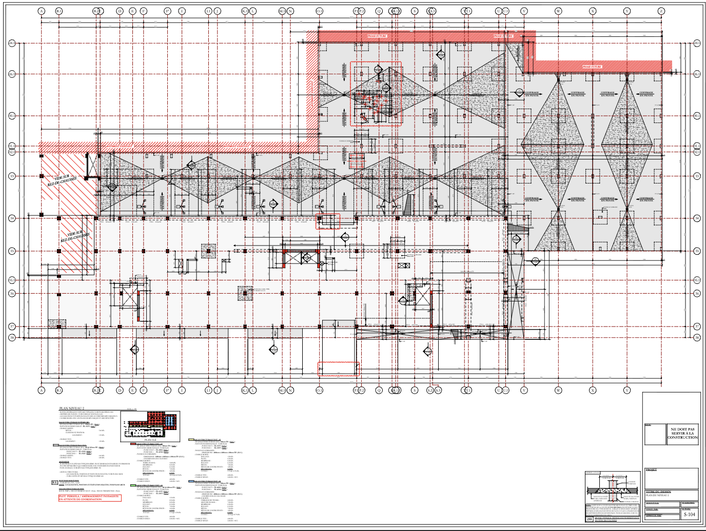

<div align="center">
<h1> CodeML 2026 - L2C Challenge (Computer Vision) </h1>



<label > sample of one of the plan's sheets</sample7500>

</div>

## Abstract & Problem description:

In the context of the CodeML hackathon that was held by PolyAI in october 2026, 
I chose to attempt the L2C challenge, which expected to provide a solution to properly parse Buildings Engineering plans from both L2C (consistent format) and all of their partner companies that would implement the plan and then return a plan (format varies depending on the partner firm), parse both and for all relevant data in a formated way and then provide a PDF pointing out the inconsistencies between the plan and the partner's output if any

## Table of Contents :

- [#Reasoning and planning](#reasoning-and-planning)
- [#Implementation details](#implementation-details)
- [#Issues and mistakes](#mistakes)
- [#Unsolved challenges](#unsolved-challenges)
- [#Conclusion](#conclusion)

## Reasoning and planning :

At first glance, knowing how diverse the PDF format can be, my first idea was to actually take a look at what those PDFs held
using pymupdf, this pointed out two things :
- The plan pdfs do contain strings, shape objects, and data that is more or less structured depending on the type
- The Partner's output (which we will refer to as DA from now on ("Dessin Atelier")) don't
Hence the initial idea of just finding a way to parse both without the need for Machine Learning went right out the window.

The next logical step for document parsing is to use some kind of trained OCR, and fine tune it for our content, but this idea also went right out the window as this document's data is not only numerical, but also made out of a varied set of symbols, "ordered" in grid-like schemes, that vary in shape and format, which hence goes beyond regular OCR text processing.

Finally, I landed on what I am most familiar with being a Vision Transformer which we planned to build from scratch and to train.
Regarding the architecture of the model itself, we also chose to incorporate a DinoV3-convnext foundational model in the conv layer
(the initial one that will scale down/patchify our image) to go around the issue that the provided dataset is ridiculously tiny (4 plans, and their DA mapping) and that no dataset of similar content was found on HuggingFace, hoping that we could get ANY transfer learning feature extraction from it (though DINOV3 was trained on a general image dataset, at least it was trained on a big enough dataset) without freezing the weights too to sort of fine tune it, we also kept a version of the ViT that doesn't contain DINOV3 and just uses a regular feature extracting CNN, the goal being to train both and see what performed best.

The training plan was the following :

Parse all plan PDFs in a way to obtain a "dictionary" of all kinds of "elements" (here an element is our unit) and their
respective features. Organize those elements in a table, where each row is an element, and each column is their feature.
Find a right H and W such that we won't ever overflow it (i.e we won't ever have more elements in a plan that there are rows, and more per-element features that there are columns) and set it as the fixed "output dimension" for our ViT for consistency (missing features/elements will be trained to be 0-ed out by the model)
And hence build our tiny (4 plans lol) dataset of ground truth, to train our ViT to predict those based on the plan's pixels
(so supervised learning).

## Implementation details

I went ahead and built (in the jupyter notebook and the ```vit_vanilla.py``` and ```vit_dinov3_augmented```) our Vision Transformer
which consisted of the following steps:

- Convolutional Layer : either our stem CNN/DINOV3 followed by a Conv2d to patchify the inital pixel fomat (huge) dividing by 128 on both H and W
- Good ole transformer blocks :  -> layer norm -> attention (self, non-causal) -> layer norm -> feed forward ->
                                  ^                                            ^ ^                            ^
                                  |____________________________________________|_|____________________________|
                                                 residual connection                 residual connection
                                                                                            
                                Repeated 6 times here

- Final output layer : Which is supposed to conv/deconv down/up to our desired format from the data processing part

Here are some hyperparameters too : 
                    
| Hyperparameter| Value |
|----|---|
| Number of Blocks  | 6 |
| Number of Attention Heads | 6 |
| Embedding dimension | 384 |
| Feed Forward dimension | 1536 |
| Optimizer | AdamW |
| DinoV3 parameters (only in non-vanilla) | 28M |
| Total parameters (vanilla) | 2446M |
| Total parameters (DinoV3) | 44M |

As for training we went with a classical AdamW optimizer (EMA based momentum + EMA weight decay regularization perks) and regular cosine learning rate with warmup, here are also some Hyperparameters about our training rate

| Hyperparameter| Value |
|----|---|
| min lr  | 1e-5 |
| max lr | 3e-4 |
| warmup_steps | 375 |
| Feed Forward dimension | 7500 |

Finally due to the shear size of our dataset, I don't think it was a reach to say that I had very little hope in such an implementation actually working, maybe perhaps I should've used a VLM

## Issues and mistakes :

I found this challenge overly hard because of five main issues:

1) The shear size of the dataset (4 plans) being so tiny
2) The diversity within the plan's formats, shapes, conventions, scales between all partners (little dataset + peak diversity is not a good combo)
4) Complexity of the format / way data is labeled and features are represented (text, numbers, lines, pictograms, chessboard positions, other...)
5) None of the data being labeled
3) Maybe is it a skill issue after all ?

In all honesty, I didn't want to go with a vision transformer initially and tried to think of any ways to go around this (Parsing the document, fine-tuning an existing OCR) but both didn't make sense due to issue 4 mainly, which landed me at the default point of building a vision tranformer which failed under issues 1 and 2. ? Maybe a VLM could have been leveraged more efficiently ?

Moreover, I should also mention that assuming the role of leadership in a team with more unexperienced members is something I liked doing, and providing decision making as well as being the pushing force of the team is something I liked to experiment, but nonetheless, maybe a more efficient team that may be more experienced with ML/Data science (the task I gave out to the other team members was for them to understand best and parse the plan format, and potentially cleanse them of any nans/bogus/irrelevant data, but that never yielded unfortunately 🦧) would have helped.

## Conclusion :

Though I don't like to publish L's (this won't see linkedin lol), I still think it has some value to it as it allowed me to work on the following :

1) Revising the ViT architecture : Hand building one more ViT is always a good refresher and allowed to consolidate the concepts in my brain
2) Understanding RoPe positional embedding 
3) Experimenting with forking my own model and comparing both forks
4) Experimenting with leadership and team leading in ML context

to be fully honest, spending the weekend on something that did not deliver and leaving still not knowing how to solve it/if it is even solvable was not really a good feeling, but at least I didn't give up and kept trying to do my best with whatever I know about ML, which I think is a very useful trait to have, as sometimes, being perseverant against a problem that seems to keep throwing jabs at you does end up in success

                                